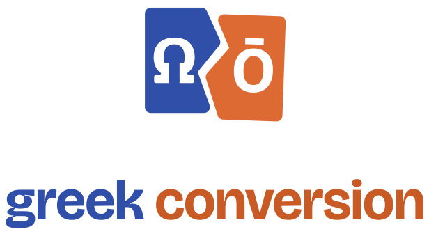

<br>

<p align="center">
  <picture>
    <source media="(prefers-color-scheme: dark)" srcset="https://raw.githubusercontent.com/defense-humanites/greek-conversion/main/docs/assets/greek-conversion-logo-sombre.svg">
    
  </picture>
</p>

<p align="center">
  <b>A TypeScript library that converts Ancient and Modern Greek between
  Greek script, Beta Code, and Latin script, with standards-based presets
  and information-loss diagnostics.</b>
</p>

<p align="center">
  <a href="https://jsr.io/@humanities/greek-conversion"></a>
  <a href="https://www.npmjs.com/package/@humanities/greek-conversion"></a>
  <a href="https://github.com/defense-humanites/greek-conversion/actions/workflows/ci.yml"></a>
  <a href="https://github.com/defense-humanites/greek-conversion/blob/main/LICENSE"></a>
</p>

<p align="center">
  <a href="https://greek-conversion.humanites.fr/"><b>Documentation</b></a> ·
  <a href="https://greek-conversion.humanites.fr/playground/"><b>Playground</b></a>
</p>

<br>

`greek-conversion` is a TypeScript library for everyone who moves Greek
between scripts:

- **Ancient and Byzantine Greek**: transliterate an edition after SBL, the
  BnF, or ALA-LC; read and write the Beta Code of the TLG and Perseus; keep
  the accents, breathings, and letter forms of polytonic text.
- **Modern Greek**: romanize names and texts after ELOT 743 and ISO 843,
  whose transcription Greek passports, road signs, and the United Nations
  use; write library records after ALA-LC; turn polytonic text into
  monotonic; build search keys and URL slugs.

Each convention is a preset that states its references and how far it
follows them. The ALA-LC, BnF, and ISO 843 presets are tested against
examples from their published tables, and `iso-843-type-2` against every
example of the BGN/PCGN table. When a conversion cannot be reversed, the
library says what was lost instead of quietly guessing. It has no
dependencies and uses no runtime-specific API.

**Not a developer?** The
[playground](https://greek-conversion.humanites.fr/playground/)
converts in the browser, with every preset and option, and shows what each
conversion loses.

## Installation

```sh
npm install @humanities/greek-conversion   # npm
npx jsr add @humanities/greek-conversion   # JSR, which gives the command for each runtime
```

The package is ESM-only and ships its own type declarations.

## Example

```ts
import {
  convert,
  convertDetailed,
  reencode,
} from "@humanities/greek-conversion";

// Beta Code, as the TLG writes it
convert("*(/ELLHSIN E)GE/NETO", "beta-code", "greek");
// → Ἕλλησιν ἐγένετο

// Ancient Greek, with every accent and breathing, and nothing lost
const res = convertDetailed("Ἕλλησιν ἐγένετο", "greek", "transliteration");
res.output; // → Héllēsin egéneto
res.lossy; // → false

// Modern Greek, from polytonic to monotonic, as passports write it
reencode("Hi ’Athína ’eînai hi protévousa", "transliteration", {
  preset: "iso-843-type-2",
  greek: { accentuation: "monotonic" },
});
// → I Athína eínai i protévousa
```

`convertDetailed()` says what a conversion cannot carry back:

```ts
import { convertDetailed } from "@humanities/greek-conversion";

const city = convertDetailed("Θεσσαλονίκη", "greek", "transliteration", {
  preset: "iso-843-type-2",
});

city.output; // → Thessaloníki
city.lossy; // → true
city.losses[0].message; // → The target representation does not retain eta.
```

## Main functions

| You want to…                                                             | Use                                                                   |
| ------------------------------------------------------------------------ | --------------------------------------------------------------------- |
| Convert a string                                                         | `convert(input, from, to, options?)`                                  |
| Normalize or restyle a string without changing its format                | `reencode(input, format, options?)`                                   |
| Know whether the conversion loses information, and where each token went | `convertDetailed(input, from, to, options?)`                          |
| Bind a preset, add characters, or restrict the repertoire                | `createConverter(configuration)`                                      |
| Inspect or edit the parsed text itself                                   | `parse()` and `encode()` from `@humanities/greek-conversion/document` |
| Bundle only the formats and presets a web page uses                      | `convert()` from `@humanities/greek-conversion/core`                  |

## Documentation

- [Getting started](https://greek-conversion.humanites.fr/guide/getting-started/),
  then the pages on
  [Ancient](https://greek-conversion.humanites.fr/guide/ancient-greek/),
  [Byzantine and Medieval](https://greek-conversion.humanites.fr/guide/byzantine-greek/),
  and [Modern Greek](https://greek-conversion.humanites.fr/guide/modern-greek/).
- [Choosing a preset](https://greek-conversion.humanites.fr/guide/presets/):
  what each convention writes, and what it loses.
- [Smaller bundles](https://greek-conversion.humanites.fr/guide/smaller-bundles/),
  for a web application that uses a few formats and presets.
- [Guarantees and limits](https://greek-conversion.humanites.fr/reference/guarantees/),
  then the rest of the reference: the
  [options](https://greek-conversion.humanites.fr/reference/options/),
  [information loss](https://greek-conversion.humanites.fr/reference/information-loss/),
  and the [API](https://greek-conversion.humanites.fr/api/readme/).
- [Contributing](https://github.com/defense-humanites/greek-conversion/blob/main/CONTRIBUTING.md).

## Citing and license

If you use `greek-conversion` in research or in a published resource, please
cite it; GitHub's “Cite this repository” button uses the metadata in
[`CITATION.cff`](https://github.com/defense-humanites/greek-conversion/blob/main/CITATION.cff).

Copyright (C) 2021–2026 Antoine Boquet. Released under the
[MIT License](https://github.com/defense-humanites/greek-conversion/blob/main/LICENSE)
since `1.0.0-beta.7`; earlier versions remain under AGPL-3.0-or-later. The
benchmark text,
[`bench/thucydides.ts`](https://github.com/defense-humanites/greek-conversion/blob/main/bench/thucydides.ts)
(Thucydides 1.1–1.10, from the Perseus Digital Library), is under
[CC BY-SA 4.0](https://creativecommons.org/licenses/by-sa/4.0/) and is not
part of the published packages. The greek-conversion logos under
`docs/assets/` are not covered by these licenses: all rights are reserved, as
recorded in
[`LicenseRef-greek-conversion-marks`](https://github.com/defense-humanites/greek-conversion/blob/main/LICENSES/LicenseRef-greek-conversion-marks.txt).
